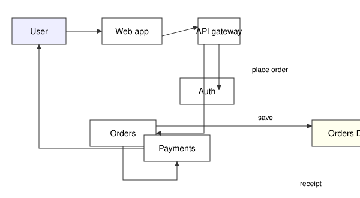
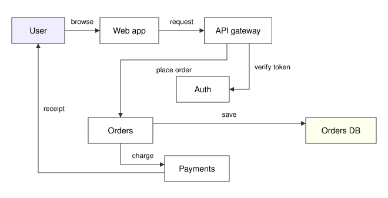

# nicevg

[](https://github.com/takagiy/nicevg/actions/workflows/ci.yml)
[](https://www.npmjs.com/package/nicevg)
[](LICENSE)

An SVG diagram tool for AI agents. It fixes a diagram's problems mechanically on the agent's behalf, and optimizes the layout while preserving the original intent.

| Before | After |
|---|---|
|  |  |

## Install

### CLI (Node 20+ or Bun)

```sh
npm install -g nicevg
# or
brew install takagiy/tap/nicevg
```

To run it once without installing: `npx nicevg < diagram.svg > fixed.svg`, or `bunx nicevg`.

### TypeScript library (Bun, Node)

```sh
npm install nicevg
```

## Examples

### CLI

```sh
nicevg < diagram.svg > fixed.svg
```

### TypeScript library

```ts
import { render, svg, text } from "nicevg";
import { box } from "nicevg/style/simple";

const image = render({
  nodes: [
    { id: "order", class: "box", x: 20, y: 20, width: 120, height: 56, label: "Order" },
    { id: "orders", class: "pill", x: 300, y: 160, label: "Orders" },
  ],
  edges: [{ from: "order", to: "orders", label: "save" }],
  style: {
    box,
    pill: ({ label }) => {
      const name = text(label);
      const w = name.width + 32, h = name.height + 20;
      return svg`
        <rect width="${w}" height="${h}" rx="${h / 2}" fill="white" stroke="black"/>
        ${name.at({ cx: w / 2, cy: h / 2 })}`;
    },
  },
  rootAttrs: { "font-family": "sans-serif" },
});
await image.write("diagram.svg");
```

## Docs

- [SVG contract](docs/reference/svg-contract.md): the attributes nicevg reads (`data-node`, `data-from`, `data-label-for`, ...)
- [Test list](docs/test-list/diagram.md): what nicevg checks, fixes and arranges, one behaviour per line
- [TypeScript library](docs/reference/typescript.md): `render()`, the sketch's fields, `style`, the result and errors
- [Development](docs/guide/development.md)
